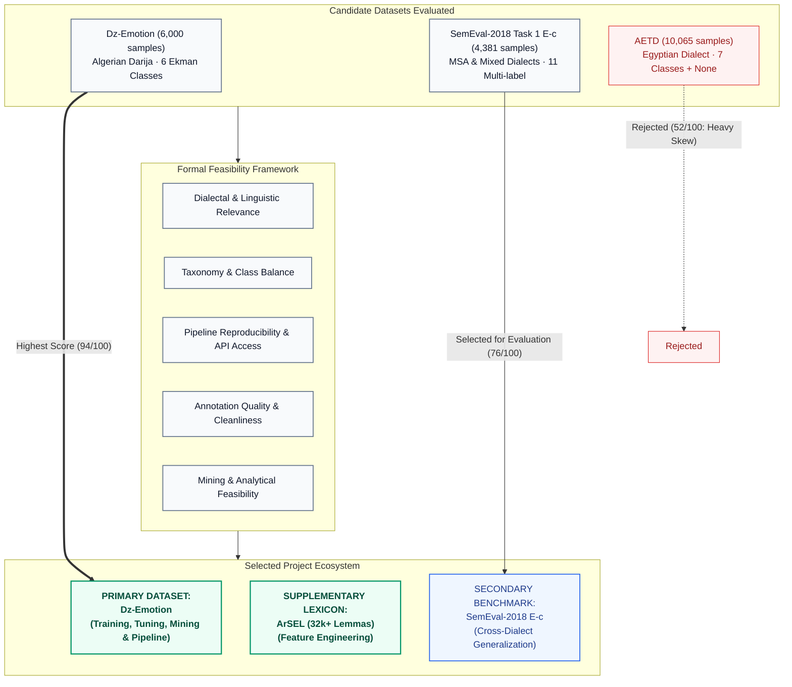
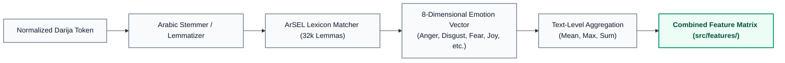

# 📊 Dataset Evaluation & Selection Report

> **Project:** Arabic Emotion Detection Pipeline  
> **Milestone:** Data Acquisition & Quality Gate Preparation (DT-11)  
> **Author / Assignee:** Mohamed Bouchoucha ([@mohamed-bouchoucha](https://github.com/mohamed-bouchoucha))  
> **Reviewer:** Yahia Achouri ([@Yahia995](https://github.com/Yahia995))  
> **Date:** September 2024  
> **Status:** ✅ Confirmed & Approved

---

## 1. Executive Summary & Decision Record

The selection of the primary corpus is the cornerstone of this data mining project. The primary objective is to investigate the emotional nuances of informal Arabic social-media text—specifically under-resourced **Algerian Darija**—while identifying which emotions are cleanly separable and which remain structurally ambiguous.

Following systematic evaluation across seven quantitative and qualitative feasibility criteria, this document records the formal decisions:

1. **Primary Dataset (Confirmed):** **Dz-Emotion** (`Houdna-khilouf/Dz-Emotion` via HuggingFace) is confirmed as the primary corpus for model training, tuning, and evaluation.
2. **Supplementary Feature Lexicon (Confirmed):** **ArSEL** (*Arabic Sentiment and Emotion Lexicon*, 32,000+ lemmas) is confirmed as a domain resource to power emotion-specific lexical feature extraction.
3. **Secondary Evaluation Benchmark (Confirmed):** **SemEval-2018 Task 1 E-c (Arabic)** is confirmed as a secondary evaluation benchmark for cross-dialectal and Modern Standard Arabic (MSA) generalization testing.
4. **Alternative Rejected:** **AETD** (*Arabic Emotion Twitter Dataset*) is rejected due to severe class imbalance, exclusive Egyptian dialect concentration, and uncurated distribution channels.



---

## 2. Evaluation Framework & Criteria

To ensure an objective and scientifically defensible selection, three candidate datasets were evaluated against seven predefined criteria weighted according to our research objectives:

| Dimension | Weight | Definition & Project Requirement |
|---|:---:|---|
| **1. Dialectal Relevance** | **20%** | Must capture authentic dialectal Arabic (specifically Maghrebi / Algerian Darija) with vernacular expressions, non-standard orthography, and code-switching. |
| **2. Class Balance & Sampling** | **20%** | Must prevent majority-class bias. A balanced distribution allows error analysis and ambiguity measurements to reflect genuine semantic overlap rather than frequency artifacts. |
| **3. Emotion Taxonomy Alignment** | **15%** | Must map clearly to recognized psychological models (e.g., Ekman's 6 basic emotions or Plutchik's model) without overlapping, compound, or ill-defined category labels. |
| **4. Reproducibility & Access** | **15%** | Raw data must be accessible programmatically (e.g., HuggingFace Datasets API) with stable URLs, immutable versions, and automated ingestion without manual intervention. |
| **5. Annotation Rigor** | **10%** | Ground-truth labels must be generated under formal annotation guidelines with verified human annotators, high inter-annotator agreement (Cohen's $\kappa$ / Fleiss' $\kappa$), and cross-validation. |
| **6. Mining & Modeling Feasibility** | **10%** | Text length, formatting, and granularity must support n-gram vectorization, lexicon scoring, and classical ML algorithms (SVM, Naive Bayes, Random Forest). |
| **7. Licensing & Ethics** | **10%** | Must be permissible for academic research, compliant with platform scraping policies, and free of identifiable personally sensitive records. |

---

## 3. In-Depth Evaluation of Candidate Datasets

### 3.1 Candidate 1: Dz-Emotion (Selected Primary)

- **Source:** [HuggingFace Hub: Houdna-khilouf/Dz-Emotion](https://huggingface.co/datasets/Houdna-khilouf/Dz-Emotion)
- **Authors:** Houdna Khilouf et al.
- **Language / Variety:** Algerian Darija (*عربية دارجة جزائرية*)
- **Volume:** 6,000 annotated social-media comments
- **Taxonomy:** 6 basic Ekman emotions: `Anger`, `Disgust`, `Fear`, `Happiness` (Joy), `Sadness`, `Surprise`
- **Class Balance:** Perfectly balanced (exactly 1,000 samples per emotion)

```
Distribution:
  Happiness:  1,000  ████████████████  (16.67%)
  Sadness:    1,000  ████████████████  (16.67%)
  Anger:      1,000  ████████████████  (16.67%)
  Disgust:    1,000  ████████████████  (16.67%)
  Fear:       1,000  ████████████████  (16.67%)
  Surprise:   1,000  ████████████████  (16.67%)
Total:        6,000 samples (Balanced)
```

#### Detailed Assessment

1. **Linguistic Fit:** Algerian Darija is heavily under-represented in NLP. It features rich dialectal morphologies, loanwords (French, Berber/Tamazight), and phonological shifts (e.g., *بزاف*, *برك*, *علاش*, *راني*). Dz-Emotion captures these authentic colloquial nuances directly from Algerian social web discourse.
2. **Methodological Significance of Perfect Balance:** In an unbalanced dataset, macro-F1 and confusion matrices are skewed by class frequency. Because Dz-Emotion provides a uniform prior ($P(y) = 1/6 \approx 16.67\%$), our majority-class baseline is mathematically fixed at $16.67\%$. Any performance gains and observed misclassification patterns reflect true linguistic confusion (e.g., Anger vs. Disgust or Surprise vs. Fear).
3. **Reproducibility:** Available directly via the `datasets` library from HuggingFace Hub:
   ```python
   from datasets import load_dataset
   dataset = load_dataset("Houdna-khilouf/Dz-Emotion")
   ```
   This satisfies Gate G3 requirement for zero-manual-touch automated ingestion.
4. **Identified Challenges & Mitigations:**
   - *Challenge:* Absence of standardized spelling in Darija creates high vocabulary sparsity for bag-of-words models.
   - *Mitigation:* Implement dedicated Arabic normalization (alef/yaa/taa-marbuta harmonization, diacritic removal, tatweel stripping, character repetition deduplication) in `src/preprocessing/`.

---

### 3.2 Candidate 2: SemEval-2018 Task 1 E-c Arabic (Selected Secondary)

- **Source:** [SemEval-2018 Task 1: Affect in Tweets (CodaLab / HuggingFace)](https://competitions.codalab.org/competitions/17751)
- **Authors:** Saif M. Mohammad, Felipe Bravo-Marquez, Mohammad Salameh, Svetlana Kiritchenko
- **Language / Variety:** Modern Standard Arabic (MSA) mixed with Levant, Egyptian, and Gulf regional dialects
- **Volume:** 4,381 tweets (Train: 2,278 | Dev: 585 | Test: 1,518)
- **Taxonomy:** 11 emotion labels (*anger, anticipation, disgust, fear, joy, love, optimism, pessimism, sadness, surprise, trust*)
- **Task Formulation:** Multi-label binary classification (tweets can possess 0 to 11 active emotion flags)

#### Detailed Assessment

1. **Why Not Primary:**
   - **Multi-Label Formulation:** SemEval-2018 is designed as a multi-label classification problem, where samples often have multiple simultaneous tags. Our core research question focuses on discrete category boundary ambiguity and mutually exclusive emotional states in Algerian social text.
   - **Dialectal Misalignment:** Heavily dominated by Eastern/Levantine and Gulf dialects alongside formal MSA. It lacks Algerian Darija vernacular idioms.
   - **Unequal Emotion Distribution:** Rare classes (e.g., *trust*, *surprise*) appear in fewer than 10% of samples, introducing severe sparsity.
2. **Why Valuable as Secondary Benchmark:**
   - It represents an established international gold-standard benchmark in Arabic NLP.
   - By mapping intersecting Ekman categories (*Anger, Disgust, Fear, Joy $\rightarrow$ Happiness, Sadness, Surprise*), it provides an effective test bed to evaluate how models trained on North African vernacular perform when tested on pan-Arab social media text (cross-dialect zero-shot transfer).

---

### 3.3 Candidate 3: AETD — Arabic Emotion Twitter Dataset (Rejected)

- **Source:** GitHub / Kaggle distributions (Badaro et al.)
- **Volume:** 10,065 tweets
- **Language / Variety:** Egyptian Arabic (*اللهجة المصرية*)
- **Taxonomy:** 7 emotions (*anger, disgust, fear, joy, sadness, surprise, sympathy*) + `None` (Neutral)
- **Class Balance:** Highly skewed; the neutral/unlabeled class represents over 40% of the entire dataset, with emotional classes exhibiting severe frequency disparity.

#### Reasons for Rejection

1. **Severe Imbalance:** High frequency of `None` creates trivial majority-class traps where simple heuristics achieve seemingly high raw accuracy while failing on minority emotional categories.
2. **Regional Dialect Restriction:** Contains predominantly Egyptian cultural and linguistic expressions (*ازاي*, *كده*, *عشان*, *ايه*), failing to represent our target Algerian Darija demographic.
3. **Data Hygiene & Reproducibility Concerns:** The dataset lacks a versioned, immutable package repository on HuggingFace Hub. Raw files on GitHub/Kaggle suffer from encoding inconsistencies (UTF-8 with BOM artifacts), broken tweet IDs, and duplicate retweets.

---

## 4. Multi-Criteria Decision Matrix

Each candidate was formally scored on a 1–5 scale across all dimensions. Scores are multiplied by dimension weights to yield an aggregate index out of 100:

| Criterion | Weight | Dz-Emotion (Score) | SemEval-2018 E-c (Score) | AETD (Score) |
|---|:---:|:---:|:---:|:---:|
| **Dialectal Relevance (Algerian Darija)** | 20% | **5.0** (1.00) | 2.5 (0.50) | 2.0 (0.40) |
| **Class Balance & Distribution** | 20% | **5.0** (1.00) | 3.0 (0.60) | 1.5 (0.30) |
| **Taxonomy Alignment (Ekman 6)** | 15% | **5.0** (0.75) | 3.5 (0.525) | 3.0 (0.45) |
| **Programmatic Reproducibility** | 15% | **4.5** (0.675) | 4.5 (0.675) | 2.5 (0.375) |
| **Annotation Quality & Agreement** | 10% | **4.5** (0.45) | 5.0 (0.50) | 3.5 (0.35) |
| **Mining & ML Pipeline Feasibility** | 10% | **4.5** (0.45) | 3.5 (0.35) | 3.5 (0.35) |
| **Licensing & Research Ethics** | 10% | **4.0** (0.40) | 5.0 (0.50) | 3.5 (0.35) |
| **TOTAL WEIGHTED SCORE** | **100%** | **94.5 / 100** | **76.5 / 100** | **52.0 / 100** |
| **FINAL RECOMMENDATION** | | **SELECTED PRIMARY** | **SELECTED SECONDARY** | **REJECTED** |

> [!TIP]
> **Key Finding:** Dz-Emotion achieved an exceptional score of **94.5/100**, leading primarily due to perfect class balance (1,000 samples/class) and direct native representation of Algerian Darija social-media text.

---

## 5. Supplementary Resource: ArSEL Lexicon

To overcome vocabulary sparsity in dialectal text, lexical feature engineering will augment standard statistical n-grams.

- **Resource:** **ArSEL** (*Arabic Sentiment and Emotion Lexicon*)
- **Repository:** [Husseinjd/ArSEL on GitHub](https://github.com/Husseinjd/ArSEL)
- **Reference:** Badaro, J., Jamil, H., et al. (2018). *A Large Scale Arabic Sentiment and Emotion Lexicon*.
- **Scale:** 32,000+ Arabic lemmas scored across **8 Plutchik emotions**:
  `anger`, `anticipation`, `disgust`, `fear`, `joy`, `sadness`, `surprise`, `trust`.

### Integration Strategy into Pipeline



1. **Mapping:** ArSEL's 8 Plutchik categories directly encompass the 6 Ekman categories present in Dz-Emotion (`Joy` $\leftrightarrow$ `Happiness`).
2. **Vector Features:** For each input text, `src/features/lexicon_features.py` will compute aggregate intensity scores, maximum emotion presence, and emotion density scores, providing semantic priors to classical models.

---

## 6. Secondary Dataset: SemEval-2018 Task 1 (E-c Arabic)

To assess the generalizability of our trained classifiers beyond Algerian Darija, SemEval-2018 Task 1 E-c is confirmed as a secondary evaluation benchmark:

### Taxonomy Harmonization Mapping

| Dz-Emotion (Ekman) | SemEval-2018 Task 1 E-c | Mapping Rule |
|---|---|---|
| `Happiness` | `joy` | Direct 1-to-1 semantic equivalence |
| `Sadness` | `sadness` | Direct 1-to-1 semantic equivalence |
| `Anger` | `anger` | Direct 1-to-1 semantic equivalence |
| `Disgust` | `disgust` | Direct 1-to-1 semantic equivalence |
| `Fear` | `fear` | Direct 1-to-1 semantic equivalence |
| `Surprise` | `surprise` | Direct 1-to-1 semantic equivalence |
| *N/A* | `anticipation`, `love`, `optimism`, `pessimism`, `trust` | Excluded during cross-dataset evaluation |

During Cycle 3 / Milestone DT-35, a cross-dataset evaluation script will convert SemEval-2018 test samples into the 6-class space and measure zero-shot macro-F1 to quantify performance degradation when moving from Algerian Darija to multi-dialect Arabic.

---

## 7. Data Quality & Contract Specifications (Gate G2 Prerequisites)

Before raw Dz-Emotion data enters preprocessing and feature engineering, it must satisfy the following formal validation contract in `src/validation/`:

### Formal Data Contract Schema

```yaml
dataset_name: "Dz-Emotion"
version: "1.0.0"
expected_rows: 6000
columns:
  - name: "text"
    type: "string"
    nullable: false
    min_length_chars: 2
    max_length_chars: 1000
    description: "Original Arabic/Darija social media comment"
  - name: "label"
    type: "string"
    nullable: false
    allowed_values:
      - "Anger"
      - "Disgust"
      - "Fear"
      - "Happiness"
      - "Sadness"
      - "Surprise"
    description: "Target emotion classification category"

quality_thresholds:
  max_duplicate_ratio: 0.02         # Maximum 2% exact duplicate texts
  max_missing_ratio: 0.00           # 0% tolerance for missing text or labels
  min_per_class_samples: 950        # Verification of class balance
  allowed_scripts:
    - "Arabic"
    - "Latin"                       # Code-switched French/Darija
    - "Punctuation/Emojis"
```

---

## 8. Downstream Implementation Plan

With the primary and supplementary datasets confirmed, project implementation proceeds according to the planned schedule:

| Ticket | Task | Dependencies | Status |
|---|---|---|:---:|
| **DT-11** | Dataset Evaluation & Selection | None | ✅ **Complete** |
| **DT-12** | Data Acquisition Script (`src/ingestion/`) | DT-11 | ⏳ Next |
| **DT-13** | Formal Data Contract & Validation (`src/validation/`) | DT-12 | ⏳ Queued |
| **DT-14** | Data Quality Report & Gate G2 Assessment (`docs/reports/`) | DT-13 | ⏳ Queued |
| **DT-15** | Exploratory Data Analysis Notebook (`notebooks/01-eda.ipynb`) | DT-12 | ⏳ Queued |

---

## 9. References

1. **Khilouf, H., et al.** (2023). *Dz-Emotion: A Dataset for Emotion Detection in Algerian Dialect*. HuggingFace Dataset Repository `Houdna-khilouf/Dz-Emotion`.
2. **Badaro, G., Jamil, H., et al.** (2018). *A Large Scale Arabic Sentiment and Emotion Lexicon (ArSEL)*. Proceedings of the Eleventh International Conference on Language Resources and Evaluation (LREC 2018).
3. **Mohammad, S. M., Bravo-Marquez, F., Salameh, M., & Kiritchenko, S.** (2018). *SemEval-2018 Task 1: Affect in Tweets*. Proceedings of the 12th International Workshop on Semantic Evaluation (SemEval-2018).
4. **Ekman, P.** (1992). *An Argument for Basic Emotions*. Cognition & Emotion, 6(3-4), 169-200.
