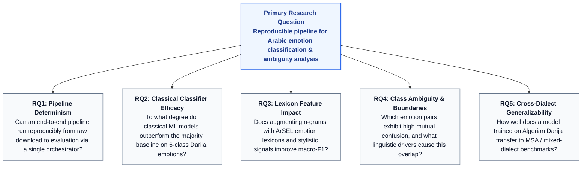
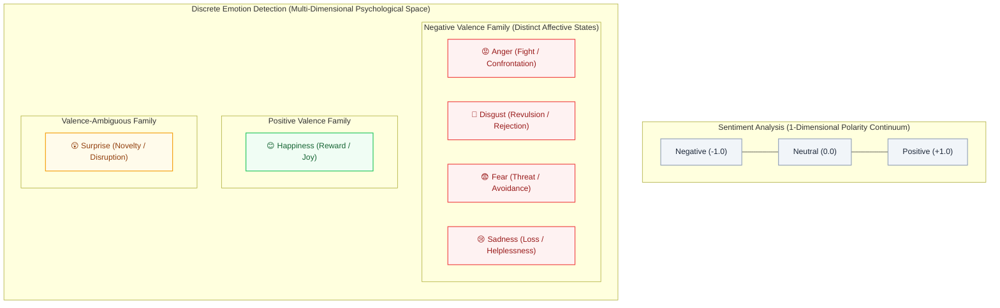
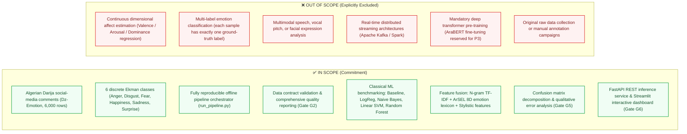
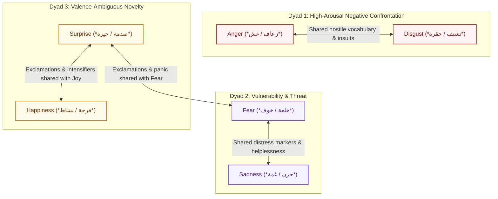

# 📐 Methodology & Research Question Specification

> **Project:** Arabic Emotion Detection Pipeline  
> **Milestone:** Cycle 1 — Project Validation & Data Foundation (M0 + M1)  
> **Status:** ✅ Validated & Approved by Research Team  
> **Gate Association:** Gate G1 (Problem Definition & Research Formulation)  
> **Lead Authors:** Yahia Achouri ([@Yahia995](https://github.com/Yahia995)) & Mohamed Bouchoucha ([@Mohamed-Bouchoucha](https://github.com/Mohamed-Bouchoucha))

---

## 1. Executive Summary & Problem Context

Emotion detection in natural language text is a crucial capability in affective computing, natural language processing, and human-computer interaction. While sentiment analysis (classifying text into positive, negative, or neutral polarities) has matured extensively across major languages, fine-grained **discrete emotion detection** remains a challenging frontier—particularly in non-standardized, morphologically rich languages such as Arabic.

The challenge is exacerbated when examining social media text originating from the Maghreb region, specifically **Algerian Darija** (*الدارجة الجزائرية*). Algerian Darija is characterized by:
- A non-standardized orthography written interchangeably in Arabic script or Arabizi (Latin script with numeric substitutions).
- Extensive lexical and syntactic borrowing, code-switching, and code-mixing with French and Berber (Tamazight).
- High morphological complexity and phonological shifts relative to Modern Standard Arabic (MSA).
- Sparse lexical and computational resources compared to MSA or Levantine/Egyptian dialects.

Without a well-defined, measurable research question, data science projects in this domain risk deteriorating into unguided model training exercises that simply report accuracy without uncovering actionable insights into language mechanics or model limitations. This document formalizes the scientific foundation of the **Arabic Emotion Detection Pipeline**, articulates the primary and operational research questions, rigorously demarcates emotion detection from sentiment analysis, and establishes the bounded methodology governing all project phases.

---

## 2. Formal Research Question

The core investigation driving this project is formulated as follows:

> [!IMPORTANT]
> ### Primary Research Question
> **"Can we build a reproducible data pipeline that automatically classifies emotions in Arabic social-media text, and can we analyze how emotional patterns differ across emotion categories, identifying which emotions are reliably detectable and which remain ambiguous?"**

### 2.1 Operational Sub-Questions (Decomposition)

To ensure scientific rigor, measurability, and empirical falsifiability, the primary research question is decomposed into five focused operational sub-questions:

#### RQ1 — Pipeline Reproducibility & Engineering
*Can an automated data pipeline ingest raw dialectal social text, validate data contracts, perform Arabic-specific normalization, generate multimodal features, and train/evaluate classifiers deterministically through a single orchestrator (`run_pipeline.py`) without manual intervention?*
- **Measurable Metric:** Binary success of automated run; zero runtime exceptions; identical MD5 checksums/splits; exact metric repeatability across independent clean environments (Gate G3).

#### RQ2 — Classification Performance & Inductive Bias
*To what extent do diverse classical machine learning algorithms (Logistic Regression, Multinomial Naive Bayes, Linear Support Vector Machines, Random Forest) outperform a majority-class baseline on 6-class Ekman emotion classification in Algerian Darija text, and which algorithm exhibits the most effective inductive bias for sparse dialectal representations?*
- **Measurable Metric:** Macro-averaged Precision, Recall, and F1-score relative to the balanced chance lower bound ($\text{Accuracy} \approx 16.67\%$, $\text{Macro-F1} \approx 0.1667$).

#### RQ3 — Affective Lexical Augmentation
*Does the fusion of statistical n-gram TF-IDF representations with domain-specific emotional lexical priors (extracted from the 32,000-lemma ArSEL lexicon) and stylistic surface features yield statistically superior macro-F1 scores compared to pure n-gram representations?*
- **Measurable Metric:** Delta in macro-F1 ($\Delta \text{F1}_{\text{macro}} = \text{F1}_{\text{fused}} - \text{F1}_{\text{tfidf}}$) across validation and test partitions.

#### RQ4 — Emotion Detectability vs. Ambiguity Profiling
*How does discriminative performance vary across individual emotion categories (Anger, Disgust, Fear, Happiness, Sadness, Surprise), which specific emotion dyads exhibit the highest rate of reciprocal misclassification, and what phonological, semantic, or cultural features in Algerian Darija drive these ambiguities?*
- **Measurable Metric:** Class-specific F1-scores; normalized pairwise off-diagonal error rates in confusion matrices ($C_{i,j}$ for $i \neq j$); qualitative categorizations of error sources (Gate G5).

#### RQ5 — Cross-Dialect Generalizability (Secondary Benchmark)
*How robust is a classifier trained exclusively on Algerian Darija social-media commentary when tested zero-shot on multi-dialectal and Modern Standard Arabic emotion corpora (SemEval-2018 Task 1 E-c)?*
- **Measurable Metric:** Relative performance retention ratio ($\mathcal{R} = \frac{\text{Macro-F1}_{\text{SemEval}}}{\text{Macro-F1}_{\text{Dz-Emotion}}}$) across mapped Ekman emotion subsets.

---

## 3. Demarcation: Emotion Detection vs. Sentiment Analysis

A pivotal requirement of this research formulation is the explicit conceptual, theoretical, and algorithmic differentiation between **Emotion Detection** and **Sentiment Analysis**. Conflating these two distinct NLP tasks introduces methodological flaws and distorts error analysis.

### 3.1 Conceptual & Theoretical Foundations

#### Theoretical Models of Affect
1. **Paul Ekman’s Basic Emotion Theory (1992):** Posits discrete, biologically rooted, universal basic emotions that evolved for adaptive survival: *Anger, Disgust, Fear, Happiness, Sadness, and Surprise*. Each state possesses distinct physiological markers, subjective feeling tones, and behavioral tendencies.
2. **Robert Plutchik’s Wheel of Emotions (1980):** Structures affective states across intensity, polarity, and dyadic combinations, providing the foundation for the ArSEL lexicon used in our feature pipeline.
3. **Russell’s Circumplex Model of Affect (1980):** Maps emotions onto a two-dimensional Cartesian plane defined by **Valence** (pleasure vs. displeasure) and **Arousal** (activation vs. deactivation). Sentiment analysis measures only the horizontal Valence axis; emotion detection demands resolution along both axes plus categorical boundaries.

### 3.2 The "Negative Collapse" Dilemma

The primary technical and operational limitation of sentiment analysis is the **Negative Collapse Problem**. In a 3-class sentiment paradigm, four of the six Ekman emotions (**Anger, Disgust, Fear, Sadness**) collapse into the identical target label: `Negative`.

| Dimension | Sentiment Analysis Approach | Emotion Detection Reality & Impact |
|---|---|---|
| **Psychological State** | Treats all unpleasant expressions as homogeneous negativity. | **Anger** triggers approach/retaliation; **Fear** triggers avoidance/escape; **Sadness** triggers withdrawal; **Disgust** triggers expulsion. |
| **Linguistic Manifestation** | Looks for negative modifiers (*مش مليح*, *خايب*, *كارثة*). | Requires fine-grained semantics: insults and hostility (*Anger*), sensory or moral aversion (*Disgust*), dread and uncertainty (*Fear*), grief and helplessness (*Sadness*). |
| **Operational Consequence** | Cannot separate panic from grief, or moral outrage from fear. | Critical for practical use cases: customer service complaints (*Anger*) require compensation, safety threats (*Fear*) require emergency intervention, product flaws (*Disgust*) require redesign. |

### 3.3 The Valence Ambiguity of "Surprise"

In sentiment analysis, **Surprise** is notoriously problematic because it is not inherently valenced:
- *Positive Surprise:* "ما كنتش حاسب نفوز! مفاجأة شابة بزاف!" (*"I never thought we'd win! Such a wonderful surprise!"*) $\to$ Positive valence.
- *Negative Surprise:* "صدمة كبيرة ما توقعتش هاد الغدر!" (*"Huge shock, I never expected such betrayal!"*) $\to$ Negative valence.
- *Neutral / Epistemic Surprise:* "غريب، تبدلت القوانين بلا ما يعلمونا" (*"Strange, the rules changed without notifying us"*) $\to$ Neutral valence.

A sentiment classifier is forced to arbitrarily partition surprise into positive or negative based on surrounding tokens, discarding the epistemic cognitive state. Discrete emotion detection treats **Surprise** as a primary target class, recognizing sudden cognitive schema revision regardless of polarity.

### 3.4 Systematic Comparison Matrix

| Property | Sentiment Analysis | Emotion Detection (This Project) |
|---|---|---|
| **Target Space** | Low-dimensional continuous or ordinal ($\{-1, 0, +1\}$ or $\mathbb{R} \in [-1, 1]$). | High-dimensional discrete categorical ($K = 6$ Ekman classes). |
| **Class Taxonomy** | Positive, Negative, Neutral. | Anger, Disgust, Fear, Happiness, Sadness, Surprise. |
| **Chance Baseline** | $33.3\%$ (balanced 3-class) or majority skew ($50\%+$). | $16.67\%$ (perfectly balanced 6-class Dz-Emotion). |
| **Subjective Nuance** | Evaluative attitude towards an entity or topic. | Internal psychological and somatic affective experience. |
| **Linguistic Complexity** | Can often succeed with polarity lexicons and bag-of-words. | Demands syntactic context, intensity markers, idioms, and dialectal nuances. |
| **Dialectal Nuance in Darija** | Simple positive/negative loan words (e.g., *bien*, *top*, *grave*). | Culturally embedded expressions (*زعاف*, *حقرة*, *خلعة*, *فرحة*, *حشمة*, *زعمة*). |
| **Decision Boundary Topology** | Linear separation often suffices along the valence axis. | Non-linear, complex multi-class boundaries with subtle inter-class overlap. |

---

## 4. Measurability, Scope Bounding & Acceptance Criteria

To protect the project from scope creep and ensure empirical verifiability, precise boundaries and quantitative acceptance thresholds are formally defined.

### 4.1 Scope Bounding

### 4.2 Quantitative Hypotheses & Success Criteria

| ID | Hypothesis / Objective | Target Metric | Minimum Threshold | Target Ideal |
|---|---|---|:---:|:---:|
| **H1** | Pipeline Determinism | Pipeline Execution Time & Code | Exit Code 0, $< 60\text{s}$ | Exit Code 0, $< 30\text{s}$ |
| **H2** | Baseline Superiority | Test Set Macro-F1 | $\text{F1} > 0.40$ (Chance = $0.167$) | $\text{F1} \ge 0.60$ |
| **H3** | Linear SVM vs. Non-linear | SVM vs. LogReg / RF Macro-F1 | Non-inferiority ($\Delta \le 0.02$) | Top-performing model |
| **H4** | Lexicon Feature Gain | $\text{F1}_{\text{TFIDF+ArSEL}} - \text{F1}_{\text{TFIDF}}$ | $\Delta \text{F1} > 0.00$ | $\Delta \text{F1} \ge 0.02$ |
| **H5** | Ambiguity Isolation | Quantified Off-Diagonal Confusion | Pairwise error cataloged | Top 3 error modes identified |
| **H6** | Data Quality Conformance | Quality Contract Verification | Completeness $\ge 99\%$, Validity $\ge 95\%$ | $100\%$ valid, 0 missing |

---

## 5. Methodological Framework: CRISP-DM & Quality Gates

The project aligns its lifecycle with the established **CRISP-DM** (Cross-Industry Standard Process for Data Mining) model, supplemented by six formal **Quality Gates** to enforce quality before advancing between phases.

### 5.1 Quality Gates Architecture

```mermaid
flowchart LR
    G1["Gate G1<br><b>Research Question & Problem Scope</b><br><i>(docs/methodology/)</i>"]
    G2["Gate G2<br><b>Data Quality & Contract Verification</b><br><i>(docs/reports/)</i>"]
    G3["Gate G3<br><b>Pipeline Reproducibility</b><br><i>(run_pipeline.py)</i>"]
    G5["Gate G5<br><b>Mining Results & Ambiguity Review</b><br><i>(docs/experiments/)</i>"]
    G6["Gate G6<br><b>Product Readiness</b><br><i>(API + Dashboard)</i>"]
    G7["Gate G7<br><b>Clean-Clone Verification</b><br><i>(Final Deliverable)</i>"]

    G1 -->|Validated Scope| G2
    G2 -->|Quality Passed| G3
    G3 -->|Deterministic Run| G5
    G5 -->|Defensible Models| G6
    G6 -->|Containers Verified| G7

    classDef gate fill:#EFF6FF,stroke:#2563EB,stroke-width:2px,color:#1E3A8A,font-weight:bold;
    class G1,G2,G3,G5,G6,G7 gate;
```

### 5.2 Quality Gate Criteria & Artifacts

| Gate | Gate Name | Focus Phase | Mandatory Criteria for Passage | Primary Artifact |
|:---:|---|---|---|---|
| **G1** | **Research Formulation** | Phase 1 (M0) | Formal research question documented; operational sub-questions defined; bounded scope agreed by all members; clear demarcation from sentiment analysis. | `docs/methodology/methodology.md` |
| **G2** | **Data Quality Gate** | Phase 2 (M1) | Raw data downloaded; contract validation passed ($\ge 99\%$ completeness, $\ge 95\%$ validity); 10 quality dimensions scored; EDA confirms balance. | `docs/reports/data_quality_report.md` |
| **G3** | **Pipeline Reproducibility** | Phase 3 (M2) | `python run_pipeline.py` executes end-to-end without errors; stratified 70/15/15 splits generated; feature matrices computed; clean execution in $<60\text{s}$. | `run_pipeline.py`, `data/processed/` |
| **G5** | **Mining Results Gate** | Phase 4 (M3+M4) | Benchmark suite executed across 5 classifiers; metrics logged in experiment tracker; best model selected by macro-F1; confusion and error analysis completed. | `docs/experiments/experiment_log.csv`, `notebooks/05-model-comparison.ipynb` |
| **G6** | **Product Readiness Gate** | Phase 5 (M5) | FastAPI `/predict` and `/analyze` operational; Streamlit dashboard connected; automated test suite passing; docker-compose brings up both services cleanly. | `api/main.py`, `dashboard/app.py`, `tests/` |
| **G7** | **Final Reproducibility Gate** | Phase 6 (M6) | Repository cloned into a clean virtual environment; setup instructions verified line-by-line; single-command reproduction validated from clone to serving. | `README.md`, Clean-clone test log |

---

## 6. Analytical Strategy for Emotion Ambiguity & Error Analysis

A defining contribution of this project is answering *which emotions are reliably detectable and which remain ambiguous* (addressing the second half of the primary research question).

### 6.1 Anticipated Linguistic Ambiguity Pairs in Algerian Darija

Based on affective semantics and sociolinguistic properties of Algerian Darija, specific pairwise confusions are hypothesized and will be empirically evaluated:

1. **Anger vs. Disgust:**
   - Both emotions inhabit high-displeasure valence and frequently co-occur in online sociopolitical commentary.
   - Expressions expressing moral indignation often use visceral terms of revulsion (*مقزز*, *يعيف*, *حاشاكم*) alongside aggressive denouncements.
2. **Fear vs. Sadness:**
   - In communal tragedies or economic hardship, commentary in Darija blends grief (*الغبينة*, *الهم*) with dread of the future (*الخلعة*, *ربي يستر*).
3. **Surprise vs. Happiness / Fear:**
   - Dialectal discourse particles such as *ياه*, *والله*, *زعمة*, and exclamation punctuation marks can signify jubilant surprise or horrific shock depending entirely on subtle unigram context.

### 6.2 Error Decomposition Protocol

During the model evaluation phase (Milestone M4 / Ticket DT-55), errors from the best-performing model will be categorized into a systematic 5-tier taxonomy:
1. **Lexical Ambiguity & Polysemy:** Words possessing divergent emotional connotations depending on context.
2. **Sarcasm & Dialectal Irony (*التمسخير / التطنز*):** Literal positive phrases conveying biting ridicule or contempt.
3. **Code-Switching & Orthographic Variance:** Darija-French-Arabic blends where transliteration variations fail to map to lexicon or vocabulary tokens.
4. **Affective Blends (Co-occurrence):** Genuine human expressions containing both sadness and anger simultaneously, where single-label ground truth enforces an arbitrary singular choice.
5. **Annotation Noise:** Ambiguous ground-truth assignments in the raw Dz-Emotion corpus identified through blind multi-annotator review.

---

## 7. Mathematical Formulation of Evaluation Metrics

To prevent any bias from class frequency distributions and provide an uncompromised evaluation, metrics are macro-averaged across all $K = 6$ classes.

Let $C \in \mathbb{R}^{K \times K}$ represent the multi-class confusion matrix, where $C_{i,j}$ denotes the number of samples with ground-truth class $i$ predicted as class $j$. For each class $k \in \{1, \dots, K\}$:

$$\text{TP}_k = C_{k,k}$$

$$\text{FP}_k = \sum_{i \neq k} C_{i,k}$$

$$\text{FN}_k = \sum_{j \neq k} C_{k,j}$$

$$\text{Precision}_k = \frac{\text{TP}_k}{\text{TP}_k + \text{FP}_k}, \quad \text{Recall}_k = \frac{\text{TP}_k}{\text{TP}_k + \text{FN}_k}$$

$$\text{F1}_k = 2 \cdot \frac{\text{Precision}_k \cdot \text{Recall}_k}{\text{Precision}_k + \text{Recall}_k}$$

The primary benchmark criterion for model selection is the **Unweighted Macro-Averaged F1-Score**:

$$\text{Macro-F1} = \frac{1}{K} \sum_{k=1}^{K} \text{F1}_k$$

This formulation penalizes models that sacrifice minority or difficult classes (e.g., Fear, Disgust) to inflate performance on simpler classes (e.g., Happiness).

---

## 8. Team Agreement & Validation Sign-Off

The research question, scope boundaries, operational sub-questions, and evaluation framework defined in this document represent the formal consensus of the research team.

| Role | Team Member | GitHub Handle | Validation Decision | Date |
|---|---|---|:---:|:---:|
| **Pipeline & Systems Lead** | Yahia Achouri | [@Yahia995](https://github.com/Yahia995) | ✅ **Approved** | 2026-09-28 |
| **Data & Evaluation Lead** | Mohamed Bouchoucha | [@Mohamed-Bouchoucha](https://github.com/Mohamed-Bouchoucha) | ✅ **Approved** | 2026-09-28 |

> [!NOTE]
> With the formal ratification of this document, **Gate G1 (Problem Definition & Research Formulation)** is officially marked **PASSED**. The team is authorized to proceed with dataset acquisition, contract verification, and exploratory data analysis.

---

## 9. References

1. **Khilouf, H., et al.** (2023). *Dz-Emotion: A Dataset for Emotion Detection in Algerian Dialect*. HuggingFace Dataset Repository `Houdna-khilouf/Dz-Emotion`.
2. **Badaro, G., Jamil, H., et al.** (2018). *A Large Scale Arabic Sentiment and Emotion Lexicon (ArSEL)*. Proceedings of the Eleventh International Conference on Language Resources and Evaluation (LREC 2018).
3. **Ekman, P.** (1992). *An Argument for Basic Emotions*. Cognition & Emotion, 6(3-4), 169–200.
4. **Plutchik, R.** (1980). *A General Psychoevolutionary Theory of Emotion*. Emotion: Theory, Research, and Experience, 1(3), 3–33.
5. **Russell, J. A.** (1980). *A Circumplex Model of Affect*. Journal of Personality and Social Psychology, 39(6), 1161–1178.
6. **Mohammad, S. M., et al.** (2018). *SemEval-2018 Task 1: Affect in Tweets*. Proceedings of the 12th International Workshop on Semantic Evaluation (SemEval-2018).
7. **Chapman, P., et al.** (2000). *CRISP-DM 1.0: Step-by-step data mining guide*. The CRISP-DM Consortium.
